<div align="center">


<br>


**Sistema de información de escritorio para controlar el mantenimiento, las herramientas y los insumos de una operación industrial.**

[Qué es](#-qué-es) · [Recorrido](#-recorrido-en-vivo) · [Funcionalidades](#-funcionalidades) · [Vistas](#-vistas-de-la-aplicación) · [Copias de seguridad](#-copias-de-seguridad-y-restauración-rf-6) · [Reportes](#-reportes-pdf-y-excel) · [Arquitectura](#-arquitectura) · [Modelo de datos](#-modelo-de-datos) · [Instalación](#-instalación-y-ejecución) · [Equipo](#-equipo)

</div>


## ▌ Qué es

**RyR ControlCenter** reemplaza las hojas de cálculo con las que hoy se lleva el control del almacén y del mantenimiento: lentas, propensas a errores y sin trazabilidad. En una sola aplicación de escritorio, **100 % offline**, se gestiona:

- la **matriz máquina–filtro** (qué filtro OEM lleva cada equipo),
- los **préstamos y devoluciones** de herramientas, maquinaria y kits, con observaciones de la inspección SST,
- el **inventario** de maquinaria, herramientas y kits, con su estado SST,
- los **insumos (filtros)** con movimientos de **Kárdex**, semáforo de existencias y punto de reorden,
- un **dashboard gerencial** con indicadores, gráficas y exportación a **PDF / Excel**,
- **usuarios, roles y una bitácora de auditoría** de cada acción crítica,
- **copias de seguridad** de la base de datos: manuales, programadas, automáticas y con restauración.

Nació como un ejercicio académico inspirado en un caso real, **RyR Global**: una operación con **500 a 650 herramientas** y un catálogo de **90 a 120 referencias de filtros**, donde el seguimiento manual genera desorden, pérdida de información y demoras en la atención de los equipos. El alcance es un **MVP funcional** construido en un semestre (8 semanas) por un equipo de seis personas, validado con la cliente.

<br>

<div align="center">

</div>

<br>


## ▌ Recorrido en vivo

Grabación de la aplicación real: Dashboard → Inventariado → Matriz máquina–filtro → Préstamos → Kárdex (movimientos, existencias y gráficas) → Usuarios y bitácora → Copias de seguridad (crear dos copias y abrir la restauración).

<div align="center">
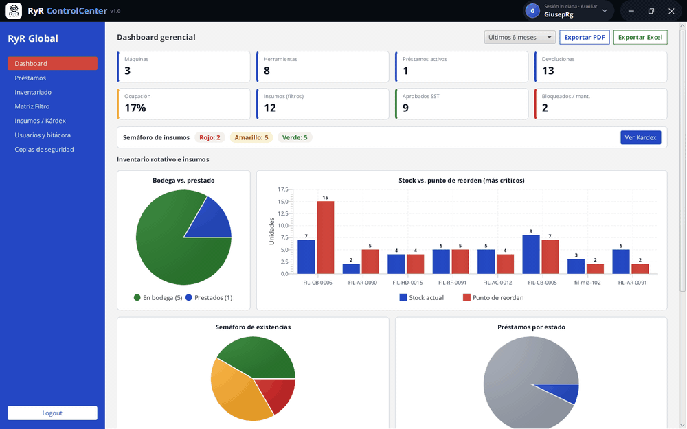
</div>

> Las capturas y la grabación de este documento se tomaron ejecutando la aplicación real (`mvn clean javafx:run` sobre la rama `main`) con la base de datos de demostración que trae el repositorio. Se capturaron en Linux con JavaFX, por lo que la tipografía y el marco de las ventanas emergentes pueden verse distintos en Windows.

<br>


## ▌ Funcionalidades

<table>
<tr>
<td width="50%" valign="top">

### ◼ Inicio de sesión
Pantalla de carga que **verifica la base de datos local** paso a paso (usuarios, inventario, préstamos, semáforo, bitácora) con logo animado, y un login con efecto *glass* sobre el fondo de la obra. Valida usuario y contraseña contra el hash guardado, actualiza el **último acceso** y deja registro del inicio de sesión en la bitácora.

### ◼ Dashboard gerencial
Ocho indicadores (máquinas, herramientas, préstamos activos, devoluciones, ocupación del inventario rotativo, insumos, aprobados SST y bloqueados / en mantenimiento), **semáforo de insumos** y seis gráficas: bodega vs. prestado, stock vs. punto de reorden (los más críticos), semáforo de existencias, préstamos por estado, entradas y salidas por mes y tendencia de entradas, salidas y préstamos. Periodo seleccionable: **3, 6 o 12 meses**. Exporta a **PDF** y **Excel**.

### ◼ Inventariado
Registro de **maquinaria, herramientas y kits agrupados** con estado SST (`Operativa`, `Bloqueada`, `Mantenimiento`, `Completo`), ubicación, stock, punto de reorden y observaciones. La **maquinaria** lleva ficha técnica (marca, modelo, serie, horómetro, área) y los **kits** se componen de herramientas del propio inventario. Búsqueda por campo (código, descripción, tipo, estado SST u observaciones) y baja lógica; no permite eliminar un activo con préstamo abierto.

### ◼ Matriz máquina–filtro
Por cada máquina, su juego de filtros por sistema — **aceite, aire, combustible, hidráulico y refrigerante** — con el **código OEM** y la referencia del catálogo con su stock. Al asociar un filtro se puede elegir uno existente o **crear uno nuevo** (categoría, unidad, stock y punto de reorden) desde el mismo formulario.

</td>
<td width="50%" valign="top">

### ◼ Préstamos y devoluciones
Salida de **maquinaria, herramienta única o kit completo** vinculada al operario (nombre y cédula) y al frente de trabajo, con fechas de salida y devolución estimada, cantidad y observaciones de la inspección SST. Valida campos requeridos, fechas, cantidad, **stock disponible** y que **ningún componente del kit** esté bloqueado o en mantenimiento. La devolución se confirma desde la tabla y queda en la bitácora.

### ◼ Insumos y Kárdex
Cuatro indicadores (existencias totales, entradas, salidas e insumos en alerta), búsqueda y filtros por categoría, tipo y fechas, y tres pestañas: **movimientos**, **existencias y reposición** (con faltante y estado) y **gráficas**. El formulario de movimiento calcula el **saldo resultante y su semáforo** antes de guardar: *Entrada*, *Salida* o *Ajuste* por conteo físico. Exporta la pestaña activa con los filtros aplicados.

### ◼ Usuarios y bitácora auditora
Alta, modificación y desactivación de usuarios (rol `Administrador` o `Auxiliar`, frente / planta, último acceso) y **bitácora** con fecha, hora, usuario, acción y módulo de cada evento crítico.

### ◼ Copias de seguridad y restauración
Copia manual, copia en la ubicación que se elija, historial con verificación de integridad, restauración con copia previa para deshacer, **programación por intervalo**, **modo automático** con retención y copia al cerrar la aplicación. [Ver detalle](#-copias-de-seguridad-y-restauración-rf-6).

### ◼ Barra de ventana propia
Barra con logo, nombre y versión, botones de minimizar / maximizar / cerrar, esquinas redondeadas y un **perfil** con el rol y el usuario de la sesión (con datos de la cuenta y cierre de sesión).

</td>
</tr>
</table>

### Semáforo de existencias

Se calcula con el stock y el **punto de reorden** de cada insumo (`KardexService.semaforo`):

| Nivel | Condición |
|:--|:--|
| ● **Rojo** — reponer | Stock agotado o por debajo del punto de reorden |
| ◐ **Amarillo** — pedir pronto | Entre el punto de reorden y un 25 % por encima (`stock ≤ ⌈reorden × 1,25⌉`) |
| ○ **Verde** — OK | Por encima del margen de seguridad |

### Ciclo de vida de un préstamo

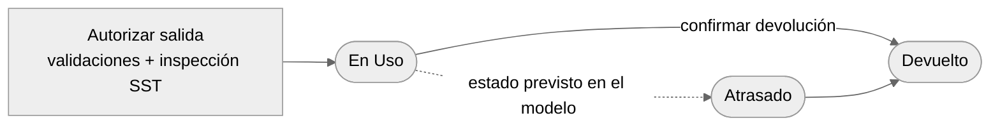

El dashboard y el inventario cuentan los préstamos `En Uso` y `Atrasado` como **préstamos activos**.

<br>


## ▌ Vistas de la aplicación

### Pre-login y login

<table>
<tr>
<td width="50%" align="center">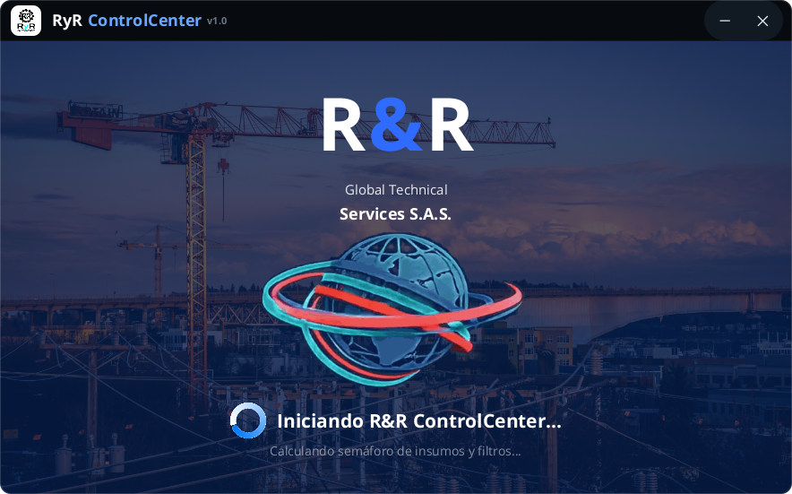<br><b>Pantalla de carga</b><br><sub>Verifica la base de datos con siete pasos y logo animado</sub></td>
<td width="50%" align="center">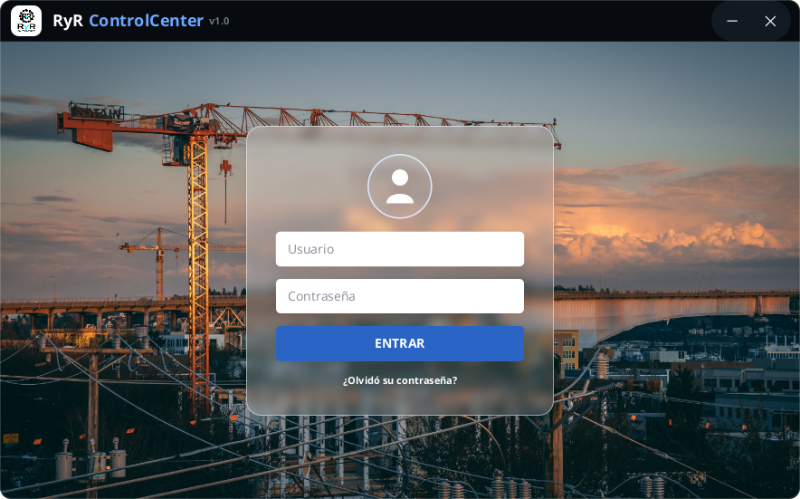<br><b>Inicio de sesión</b><br><sub>Efecto <i>glass</i> sobre la imagen de la obra</sub></td>
</tr>
<tr>
<td width="50%" align="center">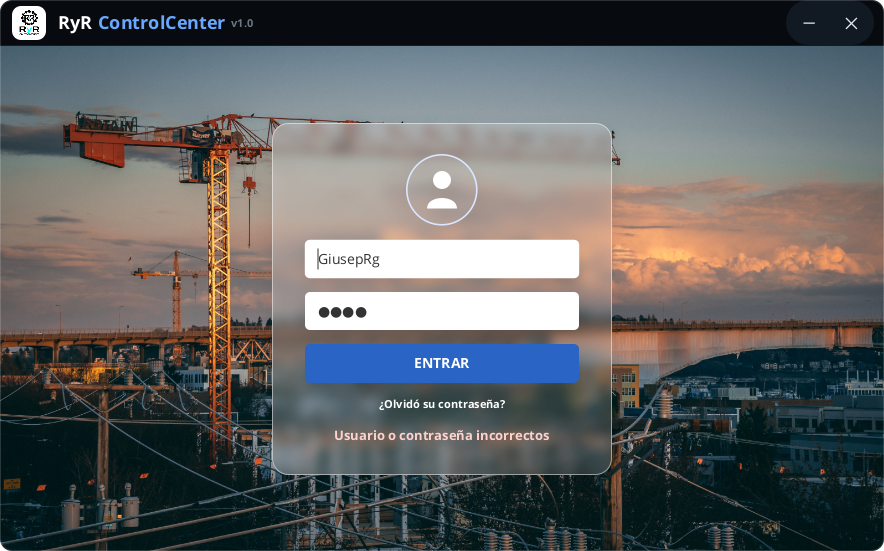<br><b>Credenciales incorrectas</b><br><sub>Mensaje en línea bajo el botón <code>ENTRAR</code></sub></td>
<td width="50%" align="center">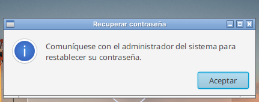<br><b>¿Olvidó su contraseña?</b><br><sub>Ventana informativa: contactar al administrador</sub></td>
</tr>
</table>

### Dashboard

<table>
<tr>
<td colspan="2" align="center">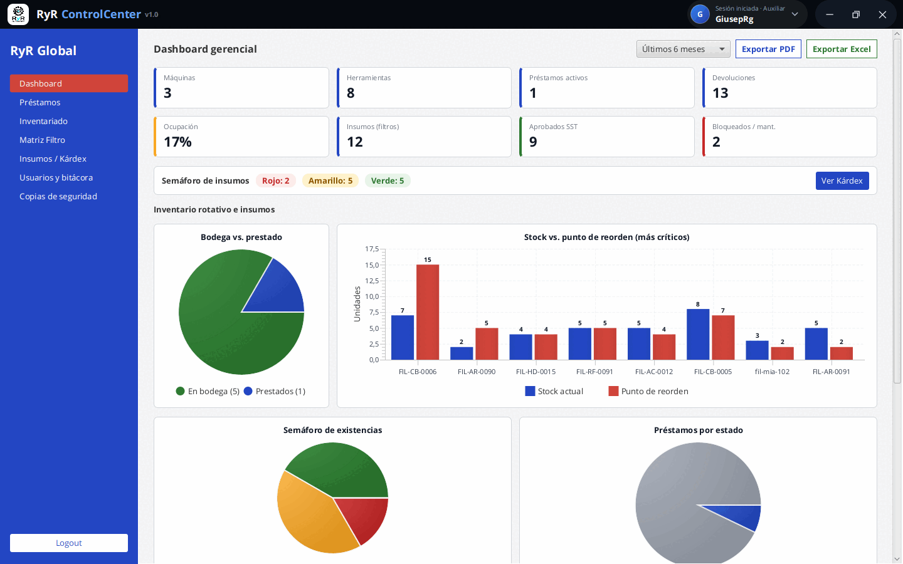<br><b>Dashboard gerencial</b><br><sub>Indicadores, semáforo de insumos y gráficas · botones <code>Exportar PDF</code> y <code>Exportar Excel</code></sub></td>
</tr>
<tr>
<td width="50%" align="center">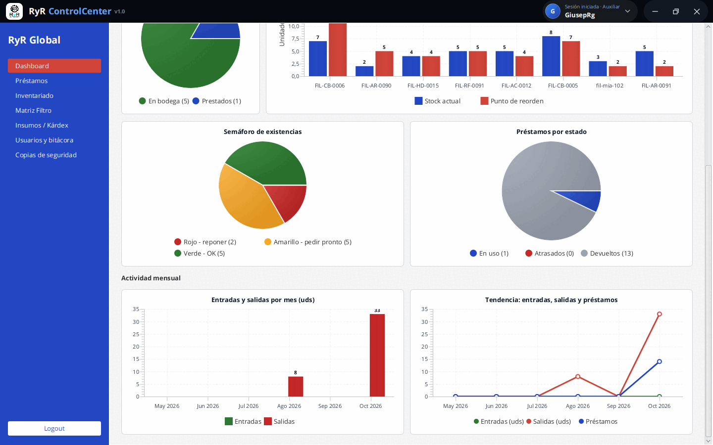<br><b>Actividad mensual</b><br><sub>Entradas y salidas por mes y tendencia con préstamos</sub></td>
<td width="50%" align="center">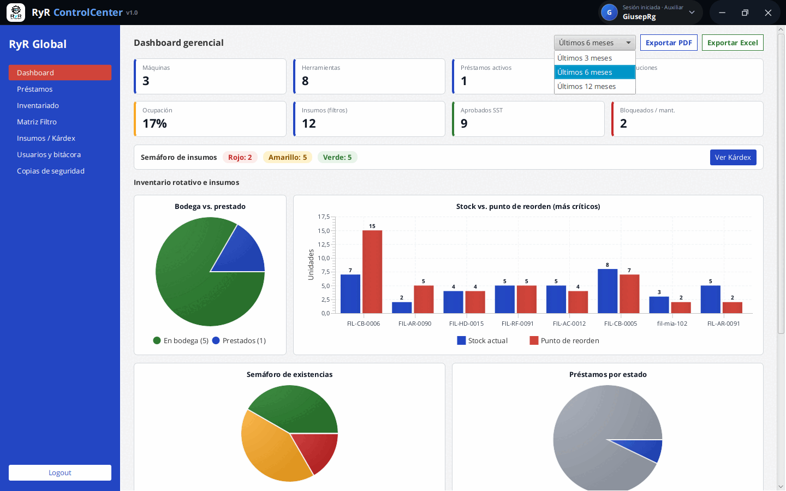<br><b>Selector de periodo</b><br><sub>Últimos 3, 6 o 12 meses</sub></td>
</tr>
<tr>
<td colspan="2" align="center">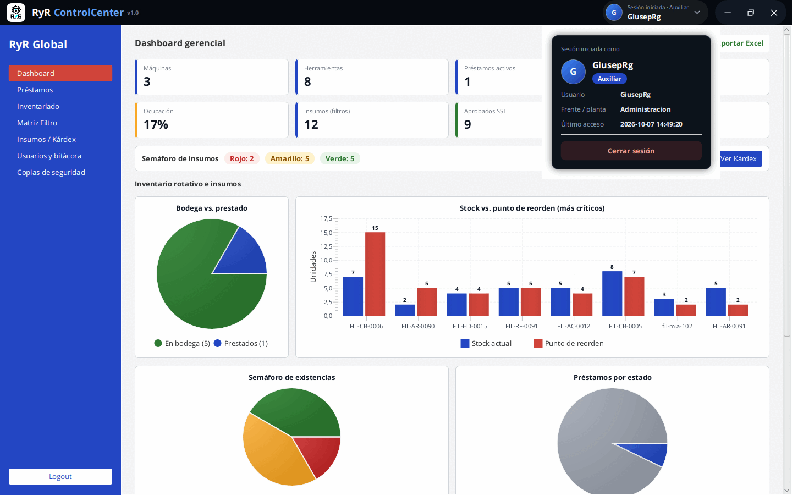<br><b>Perfil de la sesión</b><br><sub>Rol, usuario, frente / planta, último acceso y <code>Cerrar sesión</code></sub></td>
</tr>
</table>

### Inventariado

<table>
<tr>
<td colspan="2" align="center">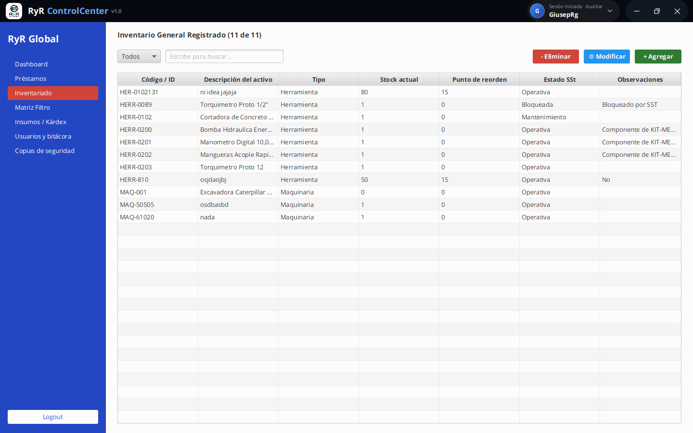<br><b>Inventario general registrado</b><br><sub>Código, descripción, tipo, stock, punto de reorden, estado SST y observaciones · búsqueda por campo</sub></td>
</tr>
</table>

<details>
<summary><b>Ventanas emergentes de Inventariado</b> (agregar, kit, maquinaria, modificar, validación y eliminar)</summary>
<br>

<table>
<tr>
<td width="33%" align="center">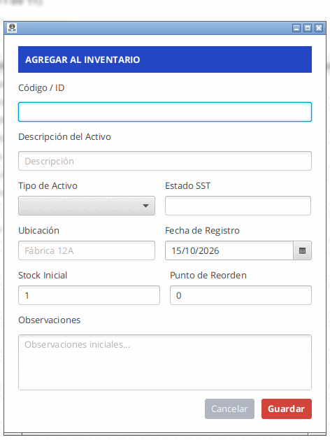<br><b>Agregar al inventario</b><br><sub>Código, descripción, tipo, estado SST, ubicación, fecha, stock y reorden</sub></td>
<td width="33%" align="center">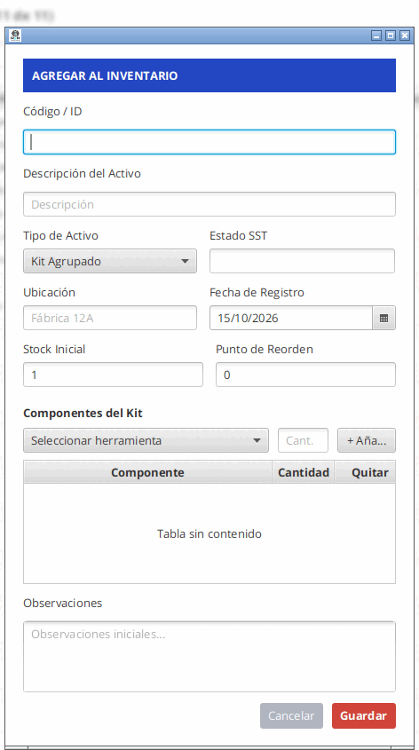<br><b>Tipo «Kit Agrupado»</b><br><sub>Aparece la tabla de componentes (herramienta + cantidad)</sub></td>
<td width="33%" align="center">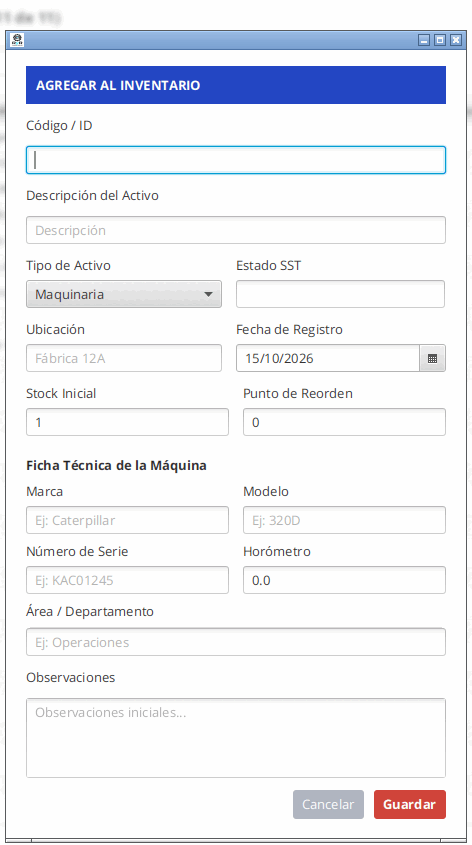<br><b>Tipo «Maquinaria»</b><br><sub>Aparece la ficha técnica de la máquina</sub></td>
</tr>
<tr>
<td width="33%" align="center">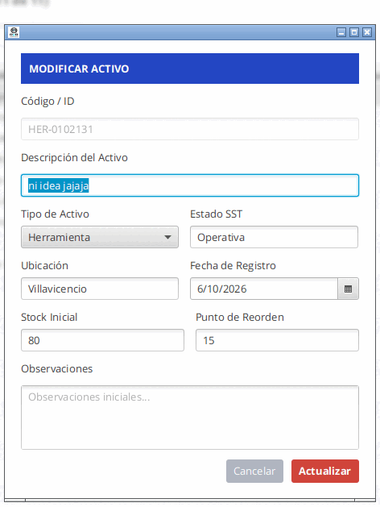<br><b>Modificar activo</b><br><sub>El código queda bloqueado</sub></td>
<td width="33%" align="center">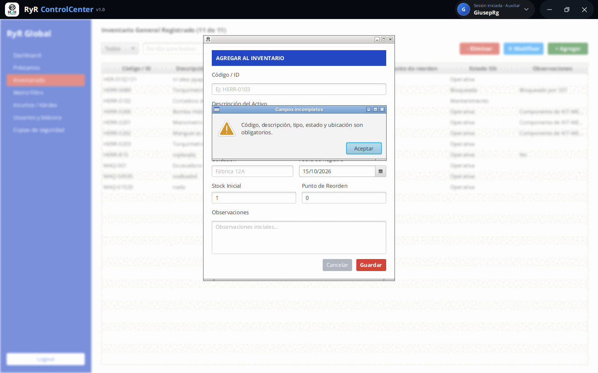<br><b>Campos incompletos</b><br><sub>Código, descripción, tipo, estado y ubicación son obligatorios</sub></td>
<td width="33%" align="center">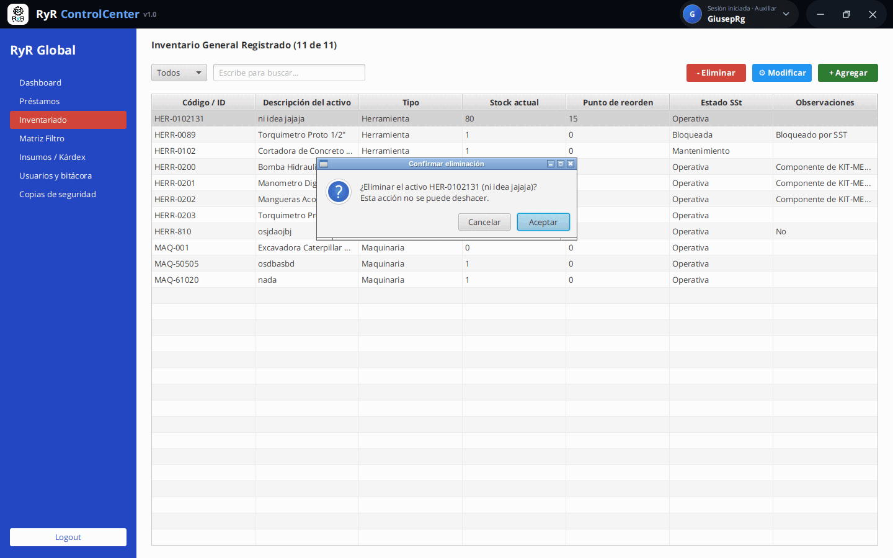<br><b>Confirmar eliminación</b><br><sub>Baja lógica; se bloquea si hay un préstamo abierto</sub></td>
</tr>
</table>

</details>

### Matriz máquina–filtro

<table>
<tr>
<td colspan="2" align="center">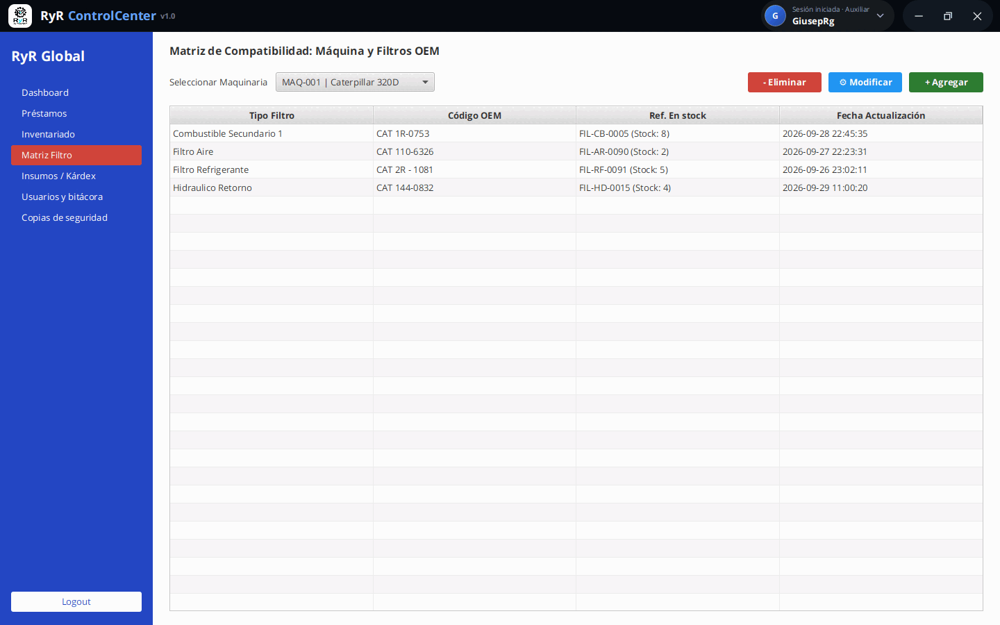<br><b>Matriz de compatibilidad: máquina y filtros OEM</b><br><sub>Selector de maquinaria · tipo de filtro, código OEM, referencia en stock y fecha de actualización</sub></td>
</tr>
</table>

<details>
<summary><b>Ventanas emergentes de la Matriz</b> (asociar, modificar y eliminar)</summary>
<br>

<table>
<tr>
<td width="33%" align="center">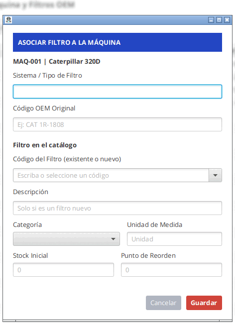<br><b>Asociar filtro a la máquina</b><br><sub>Filtro existente o nuevo (categoría, unidad, stock, reorden)</sub></td>
<td width="33%" align="center">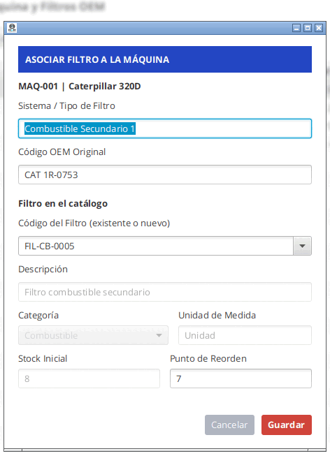<br><b>Modificar la asociación</b><br><sub>Carga la asociación seleccionada para editarla</sub></td>
<td width="33%" align="center">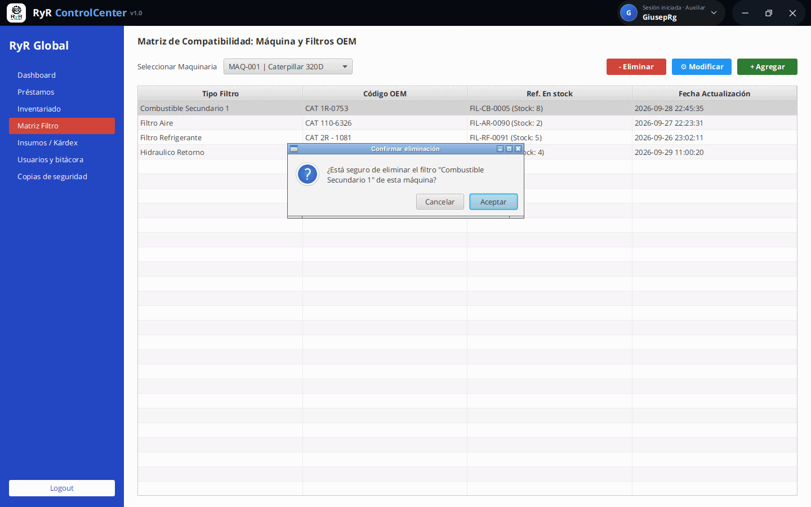<br><b>Confirmar eliminación</b><br><sub>Baja lógica de la asociación</sub></td>
</tr>
</table>

</details>

### Préstamos

<table>
<tr>
<td colspan="2" align="center">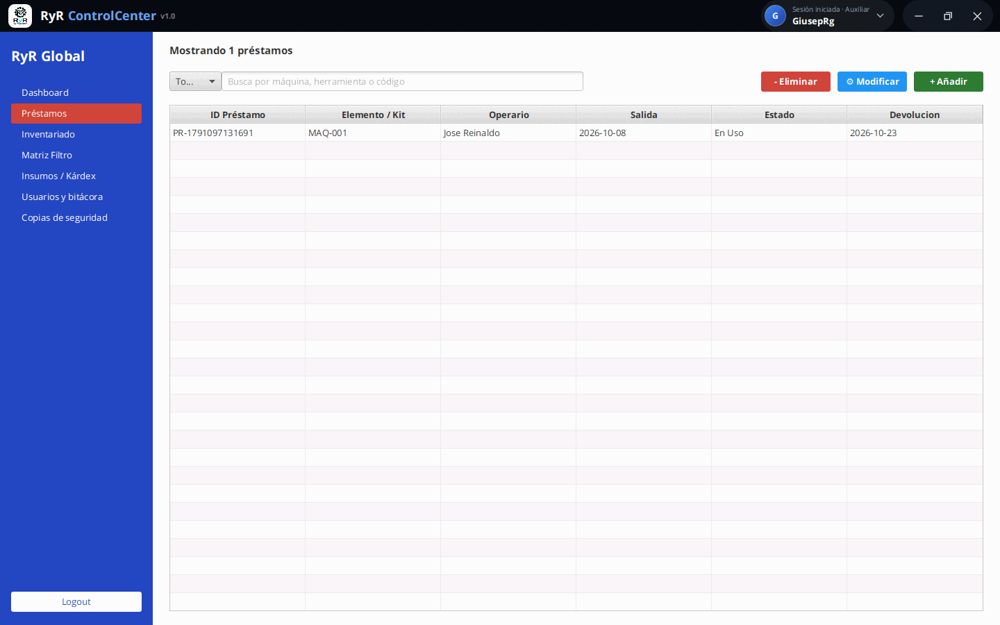<br><b>Préstamos</b><br><sub>ID, elemento / kit, operario, salida, estado y devolución · búsqueda y filtro por tipo</sub></td>
</tr>
</table>

<details>
<summary><b>Ventanas emergentes de Préstamos</b> (registrar, tipos de ítem, validación, modificar y devolver)</summary>
<br>

<table>
<tr>
<td width="33%" align="center"><br><b>Registrar nuevo préstamo</b><br><sub>Operario, cédula, inventario disponible, fechas, frente, cantidad y observaciones</sub></td>
<td width="33%" align="center">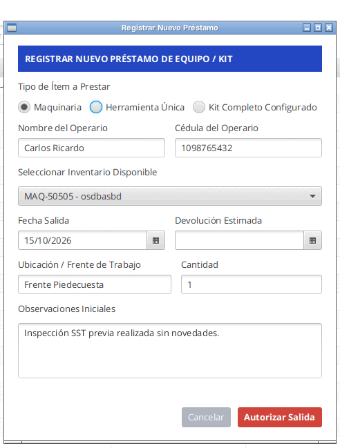<br><b>Tipo «Maquinaria»</b><br><sub>El selector lista el inventario disponible de ese tipo</sub></td>
<td width="33%" align="center"><br><b>Tipo «Kit Completo»</b><br><sub>Valida que ningún componente esté bloqueado</sub></td>
</tr>
<tr>
<td width="33%" align="center">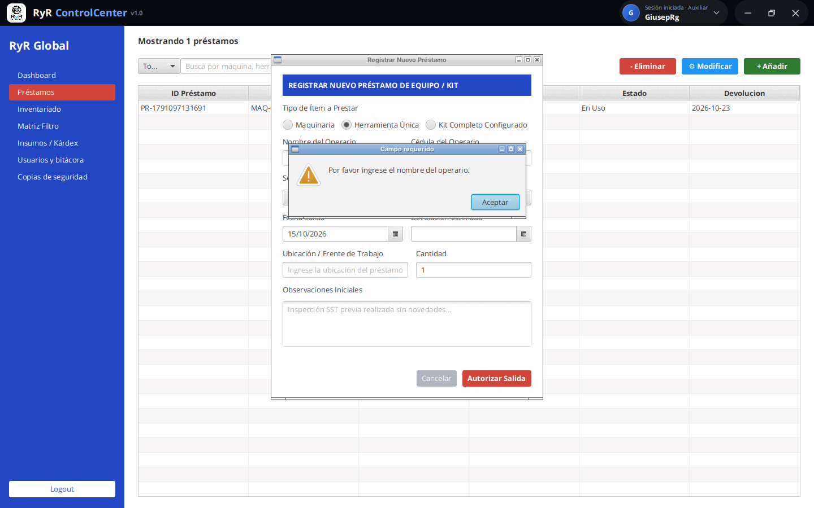<br><b>Validación</b><br><sub>Campos requeridos, fechas, cantidad y stock disponible</sub></td>
<td width="33%" align="center"><br><b>Modificar préstamo</b><br><sub>Carga los datos del préstamo seleccionado</sub></td>
<td width="33%" align="center">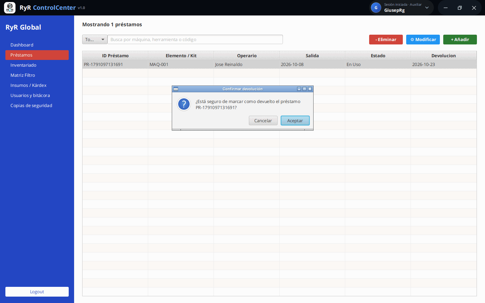<br><b>Confirmar devolución</b><br><sub>Marca el préstamo como devuelto y lo registra en la bitácora</sub></td>
</tr>
</table>

</details>

### Insumos / Kárdex

<table>
<tr>
<td colspan="2" align="center">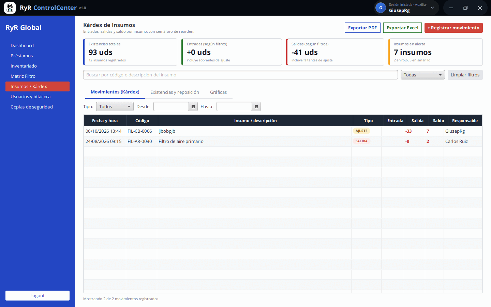<br><b>Movimientos (Kárdex)</b><br><sub>Indicadores, búsqueda, filtros por tipo y fechas · fecha, código, insumo, tipo, entrada, salida, saldo y responsable</sub></td>
</tr>
<tr>
<td width="50%" align="center">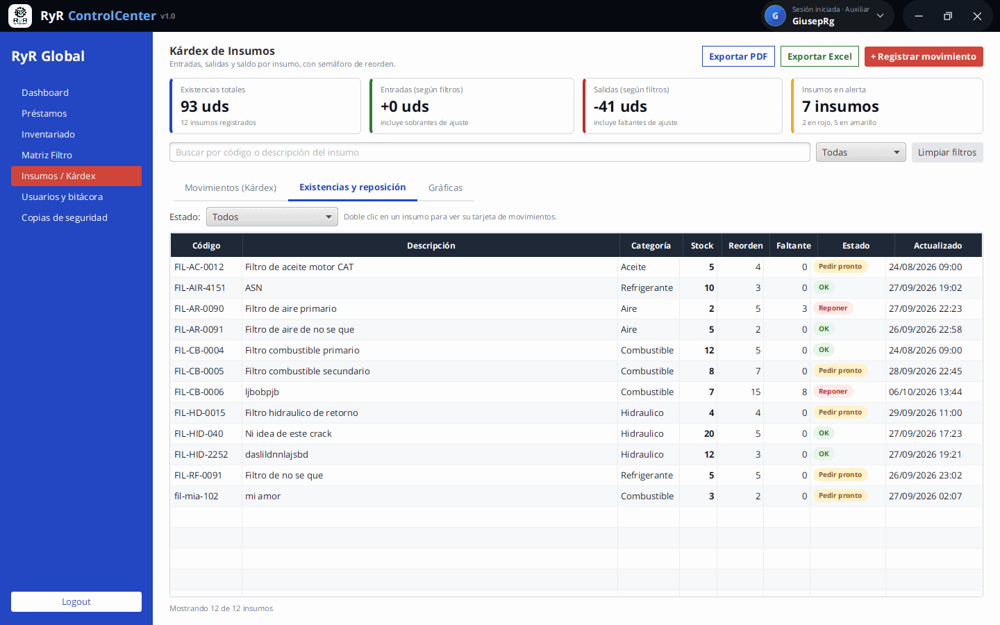<br><b>Existencias y reposición</b><br><sub>Stock, reorden, faltante y semáforo por insumo · doble clic abre sus movimientos</sub></td>
<td width="50%" align="center">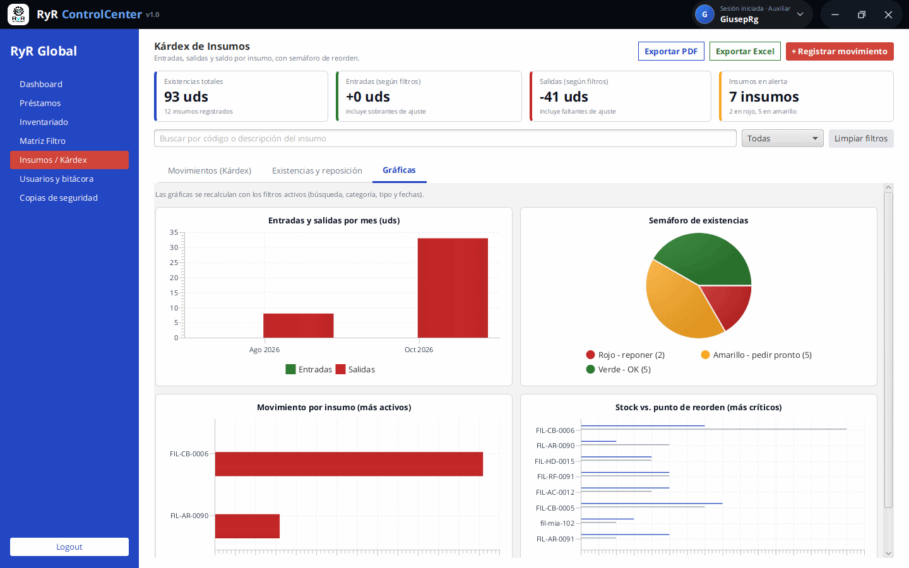<br><b>Gráficas</b><br><sub>Se recalculan con los filtros activos</sub></td>
</tr>
</table>

<details>
<summary><b>Ventana emergente de movimiento</b> (entrada, salida y ajuste)</summary>
<br>

<table>
<tr>
<td width="33%" align="center">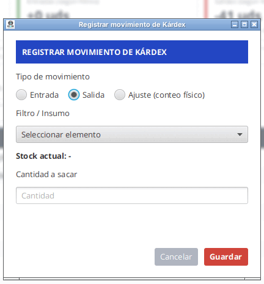<br><b>Registrar movimiento de Kárdex</b><br><sub>Tipo, insumo y cantidad</sub></td>
<td width="33%" align="center">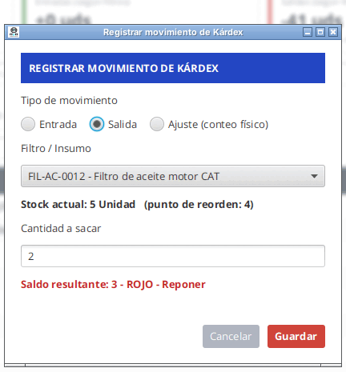<br><b>Salida</b><br><sub>Muestra el stock actual, el punto de reorden y el <b>saldo resultante con su semáforo</b></sub></td>
<td width="33%" align="center">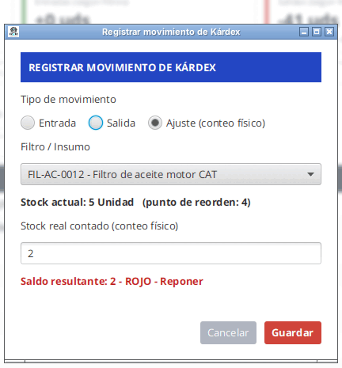<br><b>Ajuste (conteo físico)</b><br><sub>La cantidad pasa a ser el <i>stock real contado</i></sub></td>
</tr>
</table>

</details>

### Usuarios y bitácora

<table>
<tr>
<td colspan="2" align="center">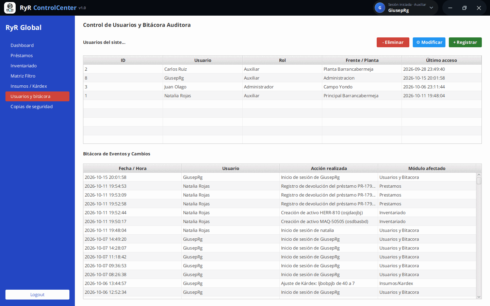<br><b>Control de usuarios y bitácora auditora</b><br><sub>Usuarios activos · eventos con fecha, usuario, acción y módulo afectado</sub></td>
</tr>
</table>

<details>
<summary><b>Ventanas emergentes de Usuarios</b> (registrar, validación, modificar y desactivar)</summary>
<br>

<table>
<tr>
<td width="25%" align="center">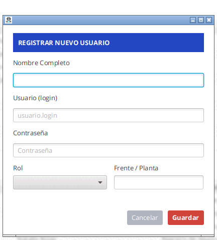<br><b>Registrar usuario</b></td>
<td width="25%" align="center">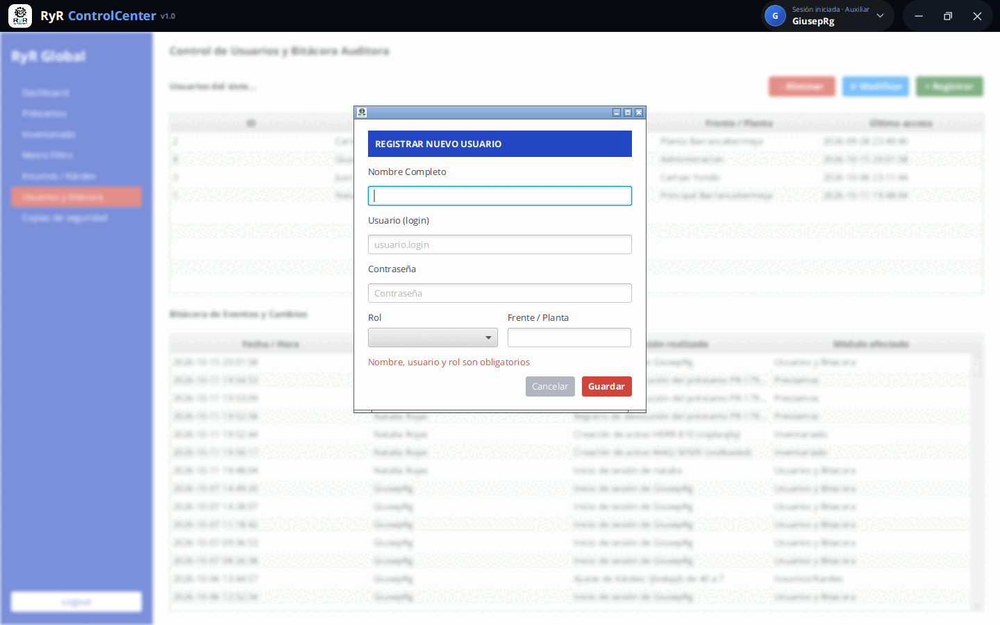<br><b>Validación</b><br><sub>Nombre, usuario y rol obligatorios</sub></td>
<td width="25%" align="center">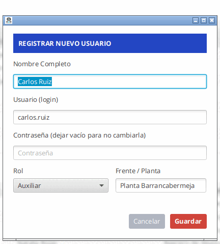<br><b>Modificar usuario</b><br><sub>Contraseña vacía = no se cambia</sub></td>
<td width="25%" align="center">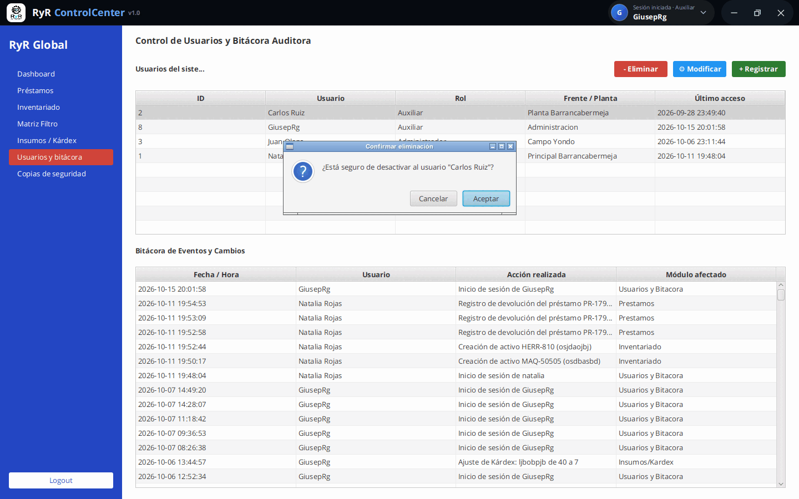<br><b>Desactivar usuario</b><br><sub>Confirmación previa</sub></td>
</tr>
</table>

</details>

<br>


## ▌ Roles y permisos

El acceso exige usuario y contraseña. Las acciones de escritura dependen del rol de la sesión: solo el rol **`Auxiliar`** puede editar (`SesionActual.puedeEditar()`); el rol **`Administrador`** tiene acceso de **consulta** — los botones de edición se ocultan en cada módulo.

| Módulo | Auxiliar | Administrador |
|:--|:--|:--|
| Dashboard (incluye exportar PDF / Excel) | ✔ consulta y exporta | ✔ consulta y exporta |
| Inventariado | ✔ agregar · modificar · eliminar | consulta |
| Matriz máquina–filtro | ✔ agregar · modificar · eliminar | consulta |
| Préstamos | ✔ registrar · modificar · devolver | consulta |
| Insumos / Kárdex | ✔ registrar movimientos · exportar | consulta · exportar |
| Usuarios y bitácora | ✔ registrar · modificar · desactivar | consulta |
| Copias de seguridad | ✔ acceso completo | ✖ «Acceso restringido» |

<table>
<tr>
<td width="50%" align="center">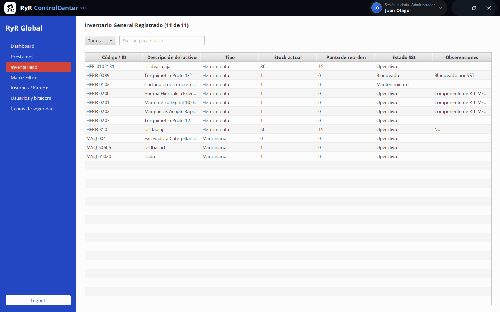<br><b>Rol Administrador · Inventariado</b><br><sub>Sin botones <code>Agregar</code>, <code>Modificar</code> ni <code>Eliminar</code></sub></td>
<td width="50%" align="center">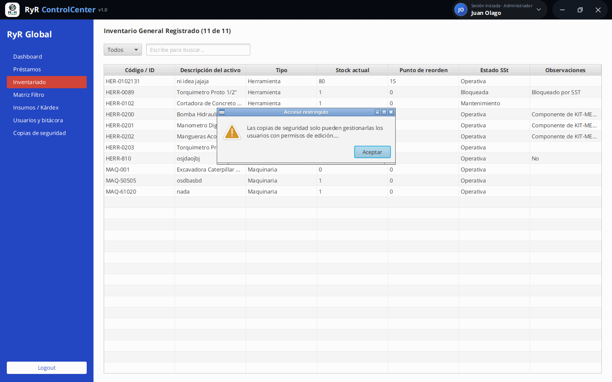<br><b>Rol Administrador · Copias de seguridad</b><br><sub>Ventana «Acceso restringido»: perfil de solo lectura</sub></td>
</tr>
</table>

> La edición se valida en la capa de controlador de cada módulo y la regla de las copias de seguridad está centralizada en `BackupController.puedeUsar()`.

<br>


## ▌ Copias de seguridad y restauración (RF-6)

Todo se hace desde **Copias de seguridad** en el menú lateral, sin salir de la aplicación ni copiar archivos a mano.

<div align="center">
</div>

<br>

<table>
<tr>
<td colspan="2" align="center"><br><b>Copias de seguridad y restauración</b><br><sub>Estado, acciones, historial y programación en una sola pantalla</sub></td>
</tr>
<tr>
<td width="50%" align="center">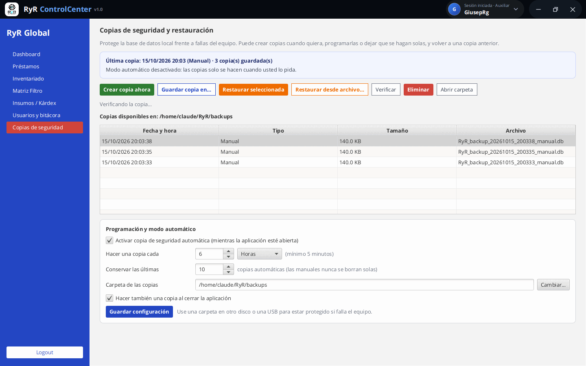<br><b>Programación y modo automático</b><br><sub>Intervalo, retención, carpeta de destino y copia al cerrar</sub></td>
<td width="50%" align="center">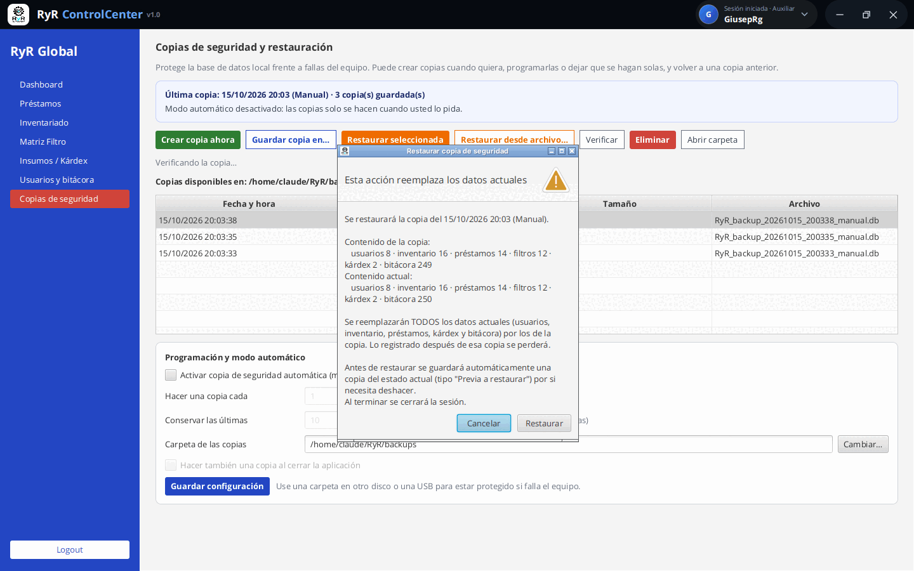<br><b>Restaurar copia seleccionada</b><br><sub>Compara los registros de la copia con los actuales y pide confirmación</sub></td>
</tr>
<tr>
<td width="50%" align="center">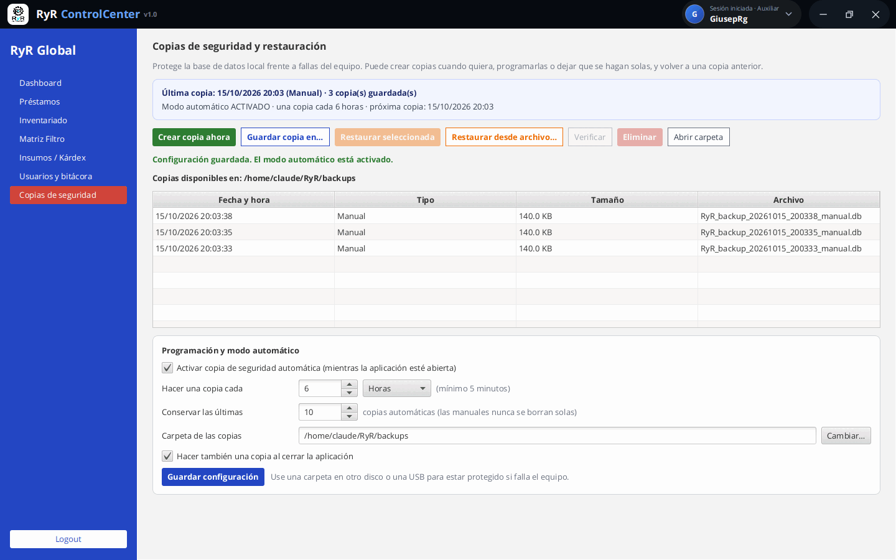<br><b>Configuración guardada</b><br><sub>El modo automático queda activo y muestra la próxima copia</sub></td>
<td width="50%" align="center"><br><b>Eliminar copia</b><br><sub>Confirmación antes de borrar el archivo</sub></td>
</tr>
</table>

### Acciones disponibles

| Acción | Qué hace |
|:--|:--|
| **Crear copia ahora** | Genera una copia manual en la carpeta de copias |
| **Guardar copia en…** | Guarda una copia en la ubicación que elija el usuario (disco externo o USB), añadiendo `.db` y sin sobrescribir la base activa |
| **Restaurar seleccionada / desde archivo…** | Verifica la copia, muestra el contenido de la copia frente al actual (usuarios, inventario, préstamos, filtros, Kárdex y bitácora) y restaura tras confirmar |
| **Verificar** | Comprueba cabecera SQLite, `PRAGMA integrity_check` y que el esquema sea compatible con esta versión |
| **Eliminar** | Borra la copia seleccionada tras confirmar |
| **Abrir carpeta** | Abre la carpeta de copias en el explorador |
| **Programación y modo automático** | Copia cada *N* minutos, horas o días (mínimo 5 minutos), conserva las últimas *N* automáticas (1–500) y puede hacer una copia al cerrar la aplicación |

### Cómo funciona

| Tema | Detalle |
|:--|:--|
| **Copia** | `VACUUM INTO` a un archivo temporal, verificación (`integrity_check` + esquema) y movimiento atómico al destino; genera una copia consistente aunque la base esté en uso |
| **Nombre** | `RyR_backup_aaaammdd_HHmmss_<tipo>.db` con tipo `manual`, `auto`, `cierre` o `prerestauracion` |
| **Restauración** | Antes de tocar nada guarda una copia `prerestauracion`; reemplaza los datos en **una sola transacción** (`ATTACH` · `DELETE` · `INSERT` · `foreign_key_check` · comparación de conteos), hace una verificación final y, si algo falla, revierte; al terminar **cierra la sesión** |
| **Planificador** | Hilo en segundo plano: revisa cada 30 s (la primera vez a los ~15 s de abrir la app) si ya toca una copia; tras un fallo espera 5 min antes de reintentar. **Solo corre mientras la aplicación está abierta** |
| **Retención** | Solo se depuran las copias `auto` y `cierre`; las manuales y las previas a restaurar no se borran solas |
| **Configuración** | `data/backup.properties` (carpeta, intervalo, retención, modo automático, copia al cerrar) |
| **Registro** | Cada operación se anota en la bitácora (módulo *Usuarios y Bitacora*) y en `data/backup.log` (rota a `backup.log.old` a 1 MB), porque una restauración revierte también la bitácora de la base |
| **Git** | `backups/`, `data/backup.properties` y `data/backup.log*` están en `.gitignore` |

Más detalle técnico en [`docs/copias_de_seguridad.md`](docs/copias_de_seguridad.md).

<br>


## ▌ Reportes PDF y Excel

Los escritores de **PDF** (`PdfDocumento`) y **XLSX** (`XlsxWriter`) están hechos a la medida, **sin librerías de terceros**. Se exporta desde el Dashboard (`Exportar PDF` / `Exportar Excel`) y desde el Kárdex, donde el archivo corresponde a la **pestaña activa con los filtros aplicados**. Cada reporte incluye el usuario que lo generó, la fecha y la numeración de páginas.

<table>
<tr>
<td width="25%" align="center">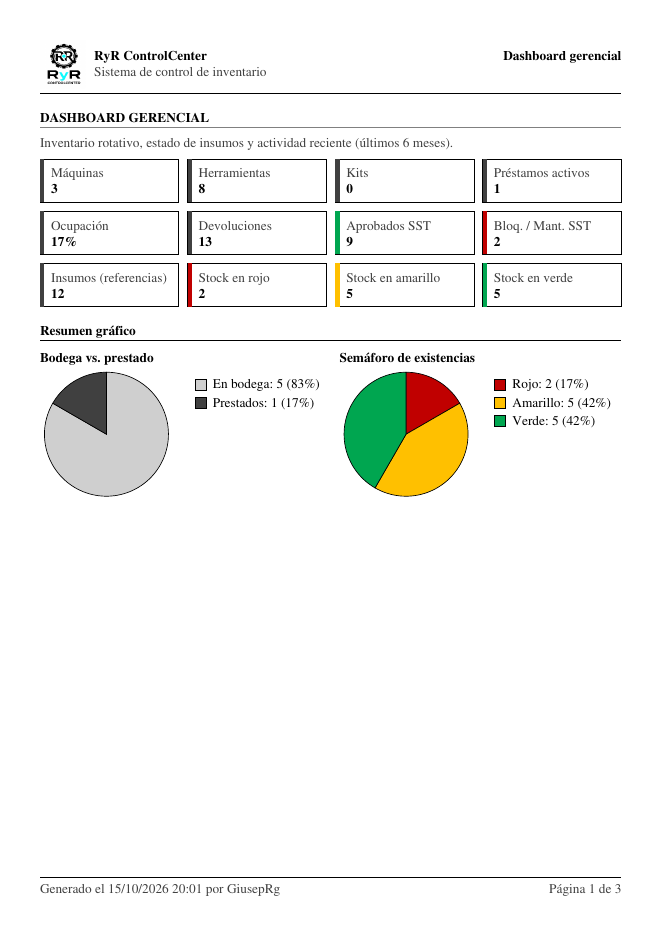<br><b>Dashboard</b><br><sub>Indicadores y resumen gráfico</sub></td>
<td width="25%" align="center">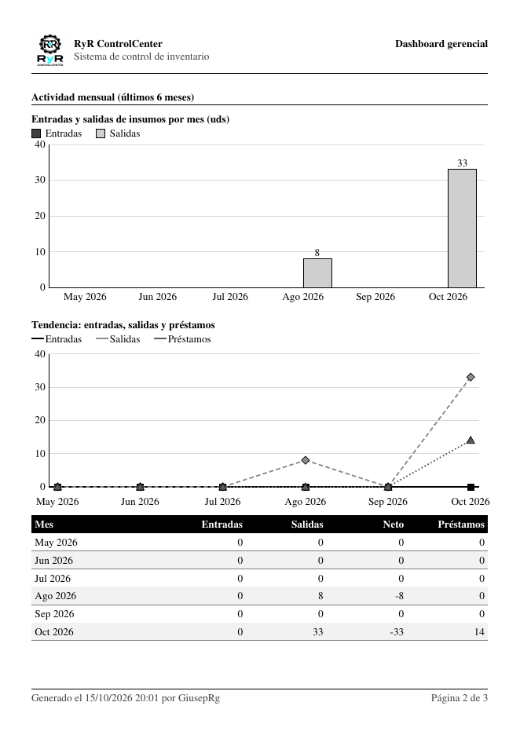<br><b>Dashboard</b><br><sub>Actividad mensual y tendencia</sub></td>
<td width="25%" align="center">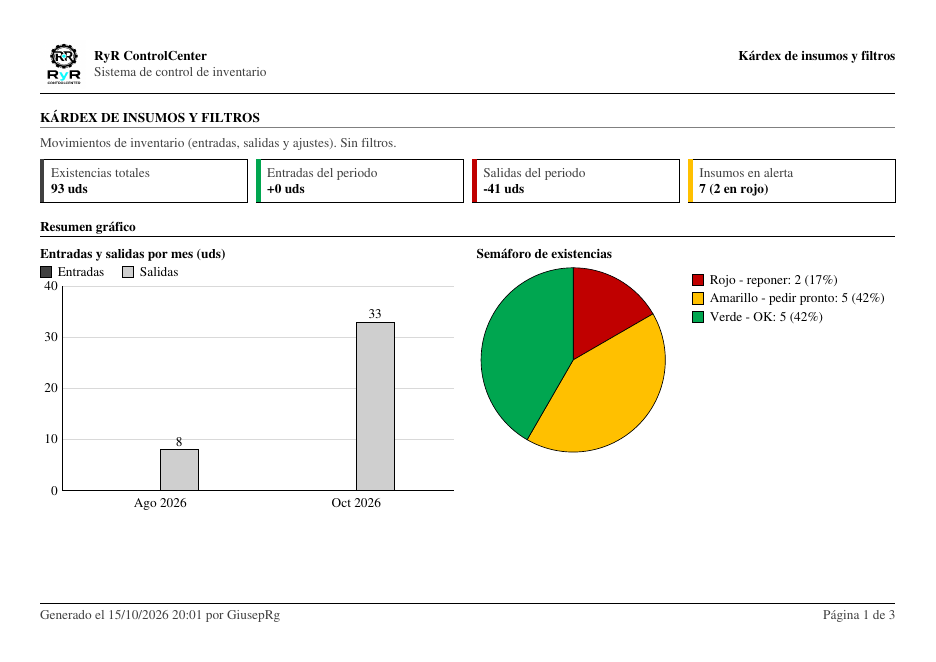<br><b>Kárdex · movimientos</b><br><sub>Indicadores, gráficas y detalle</sub></td>
<td width="25%" align="center">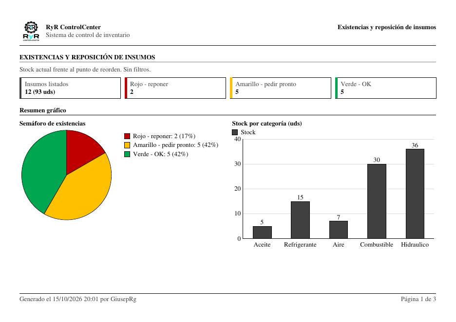<br><b>Kárdex · existencias</b><br><sub>Stock por insumo y por categoría</sub></td>
</tr>
</table>

| Reporte | PDF | Excel |
|:--|:--:|:--:|
| Dashboard gerencial | ✔ | ✔ |
| Kárdex · movimientos | ✔ | ✔ |
| Kárdex · existencias y reposición | ✔ | ✔ |

<br>


## ▌ Arquitectura

Aplicación de escritorio en capas — **MVC + DAO** — que lee y escribe directamente sobre una base SQLite embebida. Sin servidor, sin nube, sin red.

<div align="center">
</div>

### Estructura del código

```
src/main/
├── java/com/ryrcontrolcenter/
│   ├── MainApp.java            punto de entrada JavaFX · inicia el planificador de copias
│   ├── config/                 ConexionBD (JDBC + PRAGMA foreign_keys) · BackupConfig
│   ├── controller/             15 controladores: vistas principales, formularios y copias
│   ├── service/                Auth · Inventario · Kardex · Bitacora · Backup · BackupScheduler
│   ├── dao/                    10 DAOs (SQL parametrizado)
│   ├── modelo/                 12 clases de dominio (incluye CopiaSeguridad)
│   ├── reportes/               PdfDocumento · XlsxWriter · ReporteKardex · ReporteDashboard
│   └── util/                   SceneManager · SesionActual · BarraTitulo · PasswordUtil ·
│                               AlertaUtil · ExportacionUtil · FondoUtil · RedimensionUtil ·
│                               SpriteAnimacion · Precarga
└── resources/com/ryrcontrolcenter/
    ├── ui/                     15 vistas .fxml + dashboard.css · kardex.css · titlebar.css
    └── images/                 fondo del login, logo animado (sprite), spinner y logo
```

### Detalles de la interfaz

| Elemento | Comportamiento |
|:--|:--|
| **Una sola ventana** | `SceneManager` cambia la vista dentro del mismo `Stage`; pre-login y login usan un tamaño fijo (884 × 505 px de contenido) y el resto de la aplicación se abre maximizada, con mínimo de 1024 × 680 y redimensionable desde los bordes |
| **Barra propia** | Ventana sin decoración con esquinas redondeadas (`BarraTitulo`), arrastrable, con perfil de sesión |
| **Precarga** | Mientras se muestra el pre-login se cargan en segundo plano las vistas principales (`Precarga`) para que el cambio de pestaña sea ágil |
| **Formularios** | Ventanas modales (`Modality.WINDOW_MODAL`) que difuminan la ventana principal y recargan la tabla al cerrarse |
| **Avisos** | `AlertaUtil` centraliza las ventanas informativas, de advertencia y de confirmación |

<br>


## ▌ Modelo de datos

Nueve tablas relacionales en `data/ryr_controlcenter.db`, con **claves foráneas activas** (`PRAGMA foreign_keys = ON` en cada conexión), restricciones `CHECK` en los estados y **eliminación lógica** (`visible`) en inventario, matriz y préstamos. El diagrama se generó a partir del esquema real de la base incluida.

<div align="center">
</div>

| Tabla | Contenido |
|:--|:--|
| `usuarios` | Cuentas, rol (`Administrador` / `Auxiliar`), frente / planta, último acceso y estado `activo` |
| `inventario` | Maquinaria, herramientas y kits: estado SST, ubicación, stock y punto de reorden |
| `maquinas` | Ficha técnica de la maquinaria (1:1 con `inventario`) |
| `kit_detalle` | Herramientas que componen cada kit y su cantidad |
| `filtros` | Catálogo de filtros / insumos: categoría, unidad, stock y punto de reorden |
| `matriz_filtro` | Filtro OEM de cada máquina por sistema (único por máquina y sistema) |
| `movimientos_kardex` | Entradas, salidas y ajustes con el saldo resultante y el responsable |
| `prestamos` | Salidas y devoluciones con operario, fechas, estado y cantidad |
| `bitacora` | Auditoría: fecha, usuario, acción, módulo y referencia |

<br>


## ▌ Seguridad y trazabilidad

| | |
|:--|:--|
| **Contraseñas** | Nunca se guardan en claro: hash **PBKDF2-HMAC-SHA256**, 600 000 iteraciones, salt aleatorio de 16 bytes, formato `iteraciones:salt:hash` y comparación en tiempo constante |
| **Control de acceso** | Permisos de escritura por rol, validados en cada módulo; las copias de seguridad exigen perfil de edición |
| **Bitácora** | Cada acción crítica queda con **fecha, hora, usuario, módulo y referencia** (`Prestamos`, `Inventariado`, `Insumos/Kardex`, `Matriz Filtro`, `Usuarios y Bitacora`), incluidos los inicios de sesión y las operaciones de copia de seguridad |
| **Integridad** | Claves foráneas activas; los movimientos de Kárdex se ejecutan en una **transacción** (`commit` / `rollback`) |
| **Respaldo** | Copias consistentes con `VACUUM INTO`, verificadas antes de guardarse; la restauración es transaccional y deja una copia previa para deshacer |

<br>


## ▌ Stack tecnológico

Versiones tomadas del `pom.xml`:

| Capa | Tecnología |
|:--|:--|
| Lenguaje | **Java 21** (`maven.compiler.release = 21`) |
| Interfaz | **JavaFX 23.0.1** (`javafx-controls`, `javafx-fxml`) · FXML + CSS |
| Base de datos | **SQLite** vía `sqlite-jdbc 3.46.1.0` |
| Registro | `slf4j-api 2.0.13` + `slf4j-simple 2.0.13` |
| Construcción | **Maven** · `javafx-maven-plugin 0.0.8` (ejecuciones `default-cli`, `debug`, `ide-debug`, `ide-profile`) |
| Reportes | Generadores propios de **PDF** y **XLSX** |
| Copias de seguridad | `VACUUM INTO`, `ATTACH`, `PRAGMA integrity_check` y `foreign_key_check` de SQLite · planificador con `ScheduledExecutorService` |

<br>


## ▌ Instalación y ejecución

**Requisitos**

- JDK **21** o superior
- Maven **3.9** o superior
- Windows 10 / 11 (64 bits)

**Pasos**

```bash
# 1. Clonar la rama
git clone --branch main https://github.com/soofiapp/RyR.git
cd RyR

# 2. Ejecutar la aplicación
mvn clean javafx:run
```

> La ruta de la base de datos es relativa (`data/ryr_controlcenter.db`), por lo que la aplicación debe iniciarse **desde la raíz del proyecto**. El repositorio incluye una base de datos de demostración con datos de ejemplo.

**Depuración**

```bash
mvn clean javafx:run@debug        # espera un depurador en localhost:8000
```

También funciona abriendo el proyecto en **NetBeans** (incluye `nbactions.xml`).

**Archivos que genera la aplicación** (ignorados por git)

| Ruta | Contenido |
|:--|:--|
| `backups/` | Copias de seguridad (carpeta configurable) |
| `data/backup.properties` | Configuración de las copias |
| `data/backup.log` | Registro de operaciones de copia y restauración |

<br>


## ▌ Metas de calidad

Objetivos definidos en la especificación de requisitos (RNF) — son metas de diseño, no mediciones de este repositorio:

| Meta | Valor objetivo |
|:--|:--|
| Consultas de inventario y matriz | ≤ **1,5 s** en el 95 % de los casos |
| Exportación de reportes PDF / Excel | ≤ **3 s** |
| Volumen soportado | 650 herramientas · 120 filtros (escalable a 2 000 – 5 000 registros) |
| Flujo diario | 20 – 30 transacciones sin retrasos |
| Disponibilidad | 100 % en jornada laboral, sin red ni internet |
| Curva de aprendizaje | Un auxiliar sin experiencia técnica opera la app con **menos de 2 horas** de capacitación |

<br>


## ▌ Documentación

| Documento | Descripción |
|:--|:--|
| [`docs/SRS_RyR_ControlCenter_v1.0.pdf`](docs/SRS_RyR_ControlCenter_v1.0.pdf) | **Especificación de requisitos de software** v1.0 · 7 requisitos funcionales y 15 no funcionales · validada con la cliente el 27/08/2026 |
| [`docs/copias_de_seguridad.md`](docs/copias_de_seguridad.md) | Módulo de copias de seguridad y restauración: funciones, archivos, funcionamiento y mapa del código |

<br>


## ▌ Hoja de ruta

Fuera del alcance del MVP v1.0 y previsto para fases futuras:

- [ ] Lectura de **códigos de barras y QR** (previa plastificación de etiquetas)
- [ ] Conectividad en **red local (LAN)** y sincronización entre varias terminales
- [ ] **Algoritmos predictivos** para sugerir compras de inventario
- [ ] Empaquetado como **ejecutable único** para Windows
- [ ] Integración con sistemas ERP / CMMS y analítica avanzada

<br>


## ▌ Equipo

<div align="center">


</div>

| Integrante | Rol |
|:--|:--|
| **Giuseppe Vargas Gutiérrez** | Project Manager · Analista de requerimientos |
| **Juan Camilo Parra Angarita** | DBA · Diseño de la base de datos SQLite |
| **Laura Sofia Patiño Parra** | Desarrolladora Frontend · UI/UX |
| **Cinthya Juliana Romero Muñoz** | Desarrolladora Backend · CRUD y seguridad |
| **Lauren Gabriela López Jiménez** | Especialista en Datos y Reportes (BI) |
| **Juan Esteban Tarazona Caro** | Ingeniero de Pruebas / QA |

**Cliente:** Nathalia Ramírez Durán — Ingeniería Industrial · *RyR Global*

<br>

<div align="center">


<br>

<sub>**RyR ControlCenter** · v1.0 · Proyecto académico inspirado en R&R Global Technical Services S.A.S.</sub>

</div>
